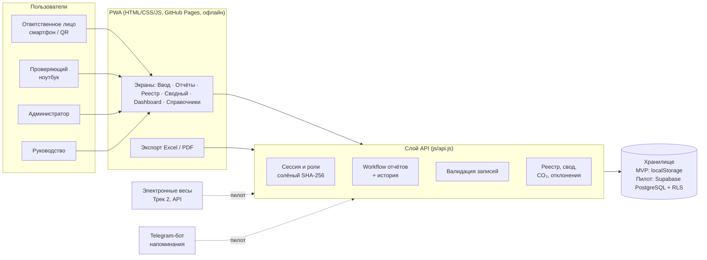
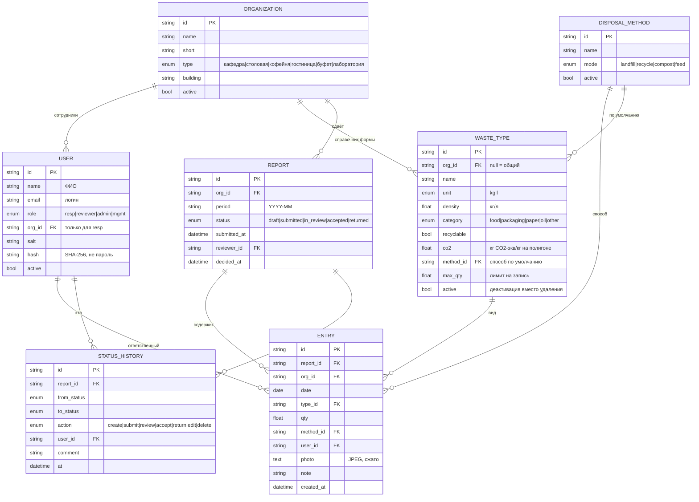
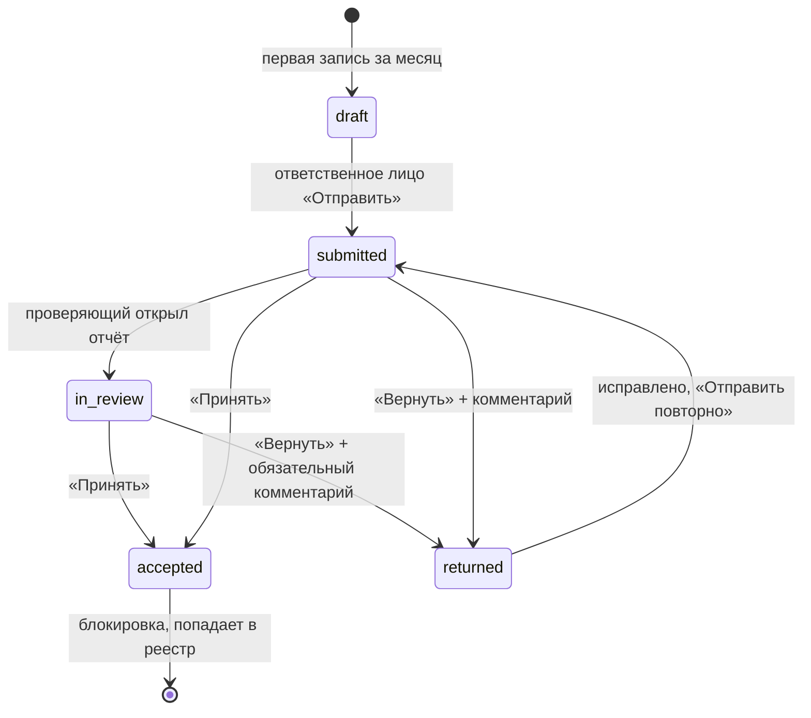

# Архитектура EcoTrack ATU

## 1. Компоненты

Принцип: UI никогда не обращается к данным напрямую. Все чтения и записи идут через методы API. Каждый метод проверяет сессию, роль (`resp` / `reviewer` / `admin` / `mgmt`) и принадлежность к организации. При переходе на Supabase тот же контракт реализуется функциями PostgreSQL и политиками RLS ([../supabase/schema.sql](../supabase/schema.sql)).

## 2. ER-диаграмма

Правила ТЗ:
* итоги за день и месяц **не хранятся**, а вычисляются из записей;
* единый реестр — это записи отчётов со статусом `accepted`;
* вид отхода, по которому есть записи, удалить нельзя, только деактивировать;
* одна организация и один месяц дают один отчёт (уникальная пара `org_id + period`).

## 3. Жизненный цикл отчёта

Статус `returned` работает как черновик (записи можно редактировать) и показывает комментарий проверяющего. Каждый переход, а также правка или удаление записи пишутся в `STATUS_HISTORY`.

## 4. Процесс «как есть» → «как будет»

```mermaid
flowchart TB
  subgraph AS_IS["Как есть (бумага / разрозненные Excel)"]
    a1[Взвешивание] --> a2[Запись в бумажный журнал<br/>~1,5 мин] --> a3[Конец месяца: перенос в Excel<br/>~2 ч на организацию]
    a3 --> a4[Отправка файла по почте] --> a5[Проверяющий сводит 5 таблиц,<br/>ищет ошибки, переписывается<br/>~12 ч/мес]
    a5 --> a6[Квартальный отчёт вручную]
  end
  subgraph TO_BE["Как будет (EcoTrack ATU)"]
    b1[Взвешивание] --> b2[QR → плитка → вес → «Сохранить»<br/>≤ 30 с, 3 касания] --> b3[Автоитоги, автопроверка, черновик]
    b3 --> b4[«Отправить» — 1 действие] --> b5[Проверяющий: принять / вернуть<br/>~15 мин на отчёт]
    b5 --> b6[Реестр, свод, Excel, dashboard — автоматически]
  end
```

| Операция (5 организаций, ~440 взвешиваний в месяц) | Как есть | Как будет |
|---|---|---|
| Запись взвешиваний | 440 × 1,5 мин ≈ 11 ч | 440 × 0,5 мин ≈ 3,7 ч |
| Перенос бумажного журнала в Excel | 5 × 2 ч = 10 ч | 0 |
| Сведение, проверка, переписка | ≈ 12 ч | 5 × 15 мин ≈ 1,3 ч |
| Квартальный и годовой свод (в пересчёте на месяц) | ≈ 3 ч | ≈ 0,2 ч (выгрузка) |
| **Итого в месяц** | **≈ 36 ч** | **≈ 5,2 ч (−86 %)** |

*Допущения команды основаны на хронометраже заполнения образцов таблиц; на пилоте их нужно уточнить.*

## 5. Расчёты

* **Масса, кг** = количество × плотность (для литров 0,92 кг/л — отработанное масло).
* **CO₂-экв.** = масса × коэффициент вида отхода (полигон) или × 0,01 (переработка, компост, корм) — в зависимости от способа утилизации записи.
* **Потенциал снижения CO₂** = Σ по пригодным к переработке отходам, вывезенным на полигон: масса × (коэффициент − 0,01).
* **Доля пригодных** = масса видов с признаком «пригоден к переработке» / общая масса.
* **Фактически переработано** = масса записей со способом не «полигон» / общая масса.
* **Отклонение:** доля вида отхода в массе организации за месяц сравнивается со средней долей за 3 предыдущих месяца. Порог N % задаётся на dashboard. Доля не зависит от сезонности (каникулы, загрузка гостиницы) и от неполного месяца.
* **Несдавшие:** активные организации без отчёта в статусе «принято» за прошедшие месяцы периода (и за текущий месяц, если он входит в период).
